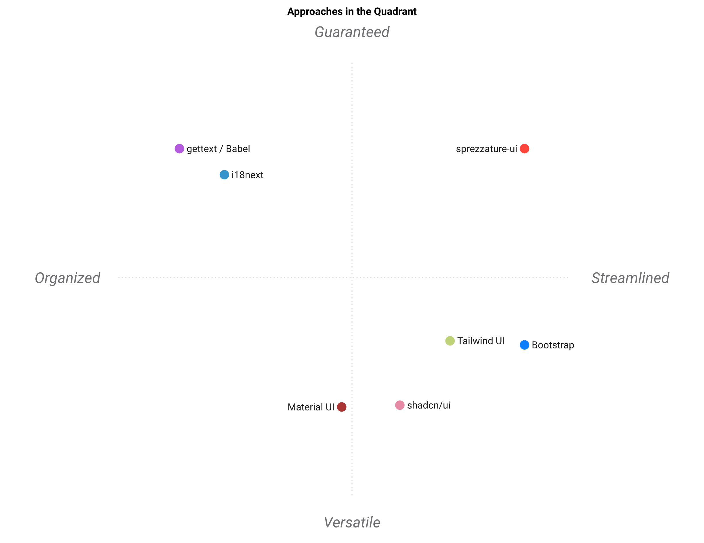

# Paysage

Ce paquet est petit, et le comparer à une bibliothèque de composants le
flatterait malhonnêtement. Il ne livre pas de composants. La comparaison juste
se fait contre **deux familles à la fois**, parce qu'il est entre les deux :

- **Les systèmes de composants et de style** — Tailwind UI, shadcn/ui,
  Material UI, Bootstrap. Ils donnent les pièces. Ils ne disent rien de
  l'endroit où vivent vos chaînes.
- **Les chaînes d'internationalisation** — i18next, gettext/Babel. Elles
  donnent un catalogue et un chargeur. Elles ne disent rien de ce à quoi
  l'interface doit ressembler.

`sprezzature-ui` ne revendique ni l'un ni l'autre territoire. Il revendique la
couture : *les chaînes de votre interface ont leur place dans un catalogue, et
voici l'audit qui trouve celles qui n'y sont pas.*

## La table, franchement

Des jugements, pas des mesures — 5 veut dire « c'est une force en octobre
2026 », 1 « il ne fait pas vraiment ça ». Écrits pour qu'on puisse contester
un chiffre plutôt qu'une impression.

| Approche | Pas de runtime de framework | i18n par catalogue | Tient en pré-commit | Règles de style écrites | Étendue des composants | Simplicité de mise en route |
|---|---|---|---|---|---|---|
| **sprezzature-ui** | 5 | 5 | 5 | 5 | 1 | 5 |
| Tailwind UI | 5 | 1 | 1 | 3 | 5 | 3 |
| shadcn/ui | 1 | 1 | 1 | 4 | 5 | 3 |
| Material UI | 1 | 2 | 1 | 5 | 5 | 2 |
| Bootstrap | 4 | 1 | 1 | 3 | 5 | 4 |
| i18next | 3 | 5 | 2 | 1 | 1 | 3 |
| gettext / Babel | 4 | 5 | 3 | 1 | 1 | 2 |

Source : [`assets/landscape.csv`](assets/landscape.csv).

## La carte



```sh
standpoint assets/landscape.csv --outdir assets
```

Produite avec [`standpoint`](https://github.com/warith-harchaoui/standpoint).
La géométrie est une ACP de corrélation, donc déterministe : la même table
donne la même carte à chaque exécution. `standpoint` écrit aussi une
interprétation en prose ; elle n'est pas reproduite ici, parce qu'un modèle
qui relit des notes écrites par quelqu'un n'est pas une découverte.

## Ce que la forme dit vraiment

**La colonne à regarder est l'étendue des composants, et c'est un 1.** Ce
n'est pas un trou à combler. Une bibliothèque de composants est ici le travail
du modèle, guidé par le `SKILL.md` de la suite — aucune route HTTP ne porte
« rends ce tableau de bord lisible », et le README le dit. Ajouter des
composants pour relever ce chiffre, ce serait prendre la largeur pour de la
valeur.

**La colonne pré-commit est presque vide dans tout le champ.** Les deux
chaînes i18n marquent 2 et 3 ; tout le reste marque 1. C'est le vrai argument
de ce paquet : une phrase écrite en dur ne coûte rien le jour où on l'écrit et
une semaine le jour où il faut une deuxième langue, et le seul outil qui aide
est celui qui est assez bon marché pour tourner à chaque commit.

**Il recouvre i18next et gettext plus que Tailwind.** Autant le dire : si vous
avez déjà une chaîne i18n qui marche, l'audit est la seule partie de ce paquet
qui vous intéresse — et il tourne à côté de la vôtre, puisqu'il cherche les
chaînes qui ne sont dans **aucun** catalogue, y compris le vôtre.

## Quand prendre autre chose

- **Il vous faut des composants** — Tailwind UI, shadcn/ui, Material UI. Ce
  paquet ne concourt pas et ne concourra pas.
- **Il vous faut la traduction à l'exécution** avec pluriels, interpolation et
  chargement différé — i18next. L'audit trouve ce qui a sa place dans votre
  catalogue ; il ne remplace pas son exécution.
- **Vous avez déjà un framework** — gardez-le. L'audit n'utilise que la
  bibliothèque standard et se moque de ce qui rend la page.

## Voir aussi

- [`sprezzature-accessibility`](https://github.com/warith-harchaoui/sprezzature-accessibility) — le HTML est-il utilisable
- [`sprezzature-colors`](https://github.com/warith-harchaoui/sprezzature-colors) — le contraste passe-t-il
- [`sprezzature-cli-gui`](https://github.com/warith-harchaoui/sprezzature-cli-gui) — quand il y a une ligne de commande derrière l'écran
